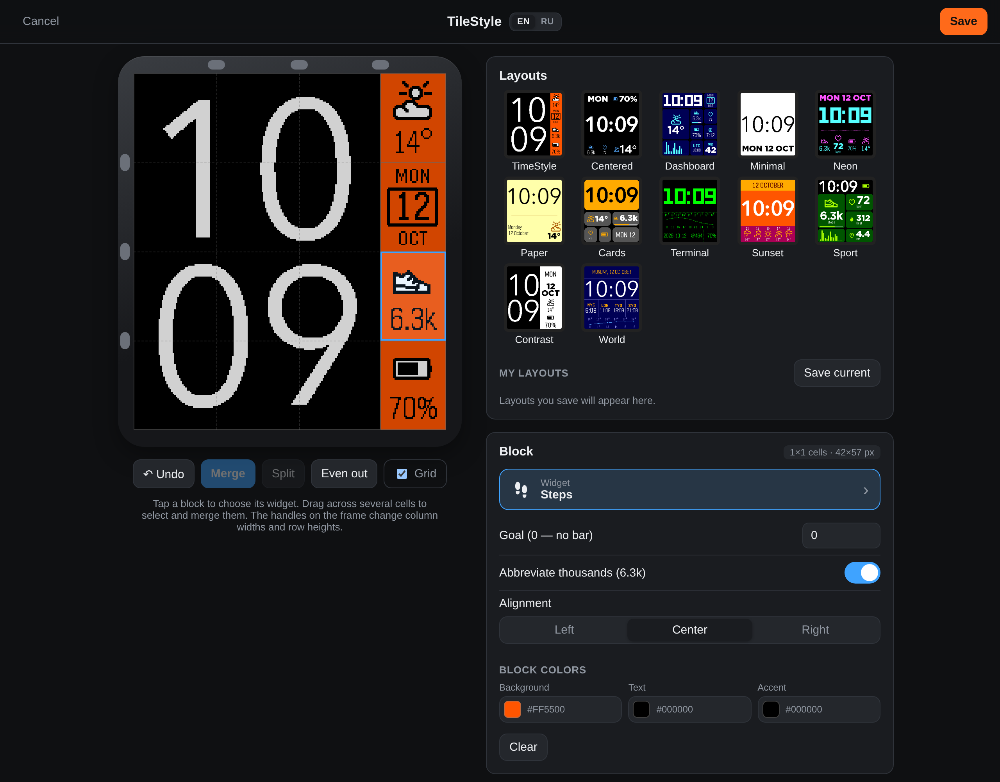
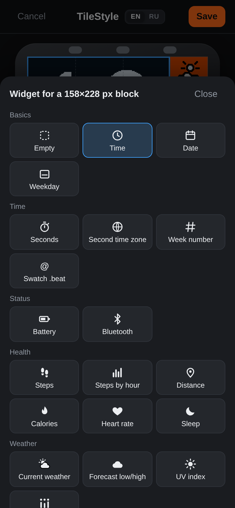
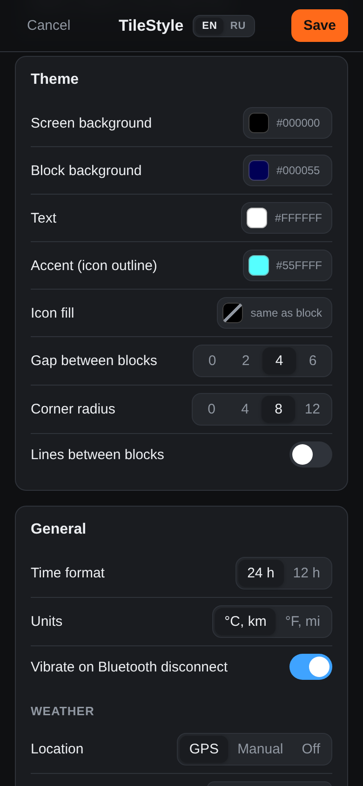

# TileStyle

[](https://github.com/MuratovAS/tileStylePebble/actions/workflows/ci.yml)

A fully customizable watchface for Pebble Time 2 (platform `emery`, 200×228,
64 colors). Split the screen into a 4×4 grid, merge cells into blocks and fill
each block with a widget: time, date, weather, health and more. Inspired by
[TimeStyle](https://github.com/freakified/TimeStylePebble) and built on its
fonts and icons.

<p>
  
</p>
<p>
  
  
</p>

## Features

- **4×4 grid.** Column widths and row heights are adjustable (20 px minimum),
  and cells merge into blocks of any rectangular size.
- **Widgets:**
  - time (Avenir, Avenir DemiBold or LECO; on one line or hours over minutes);
  - date from a pattern or as a calendar sheet, weekday, seconds, week
    number, second time zone, Swatch .beat;
  - battery, Bluetooth;
  - steps (with a goal bar and an hourly chart), distance, calories, heart
    rate, sleep;
  - current weather, today's high/low, UV index, hourly forecast (columns or
    a temperature graph);
  - custom text, divider.
- **Styling:**
  - theme colors, plus per-block overrides;
  - gaps and rounded corners between blocks;
  - lines between blocks: solid, dashed or dotted.
- **12 built-in layouts**, plus your own layouts saved on the phone.
- **Weather** from [Open-Meteo](https://open-meteo.com/), no API key needed.
  The location comes from GPS or is picked by hand.
- **Pixel-exact preview.** The settings page draws the screen exactly as the
  watch does: same firmware fonts, icons and layout.

On-watch labels are in English: the firmware fonts have no Cyrillic.

## Usage

1. Install the `.pbw` on the watch through the Pebble app, or build it
   yourself (see below).
2. Open the watchface settings in the Pebble app. This opens the settings
   page (<https://muratovas.github.io/tileStylePebble/>), where you can:
   - select cells on the preview and merge them into a block;
   - choose a widget for the block and set its options;
   - set up the theme, grid and general options: 12/24 h, units, weather,
     vibration on disconnect.
3. Tap Save. The settings are sent to the watch, and the weather is refreshed
   if the layout has weather widgets.

Until it is configured, the watch shows the TimeStyle layout.

The page is available in English and Russian. It follows the browser language;
use the EN / RU switch in the header or `?lang=en` to change it.

## Building

You need Pebble SDK 4.x, Node.js and npm. The SDK is installed with the
`pebble` tool:

    uv tool install pebble-tool
    pebble sdk install latest

Then:

    git clone git@github.com:MuratovAS/tileStylePebble.git
    cd tileStylePebble
    npm install                             # pebble-fctx library
    pebble build                            # -> build/tileStylePebble.pbw

To run it:

    pebble install --emulator emery         # Pebble Time 2 emulator
    pebble install --phone <phone IP>       # real watch, via the Pebble app

The settings page (branch `gh-pages`) is checked out into `config/` as a
worktree. The watchface builds without it, but the generators and tests in
`tools/` need it:

    git worktree add config gh-pages

## Repository layout

The branches follow TimeStyle:

- `main`: the watchface, with watch and phone code, resources and tools.
- `gh-pages`: the settings page, plain static HTML with no build step,
  served by GitHub Pages. Commit page changes from `config/`.

| Path | Contents |
|---|---|
| `src/c/` | watch code: one layer per block, widgets, drawing, data (Health, battery, Bluetooth, weather), settings storage |
| `src/c/protocol.h` | phone ↔ watch protocol: message keys, binary settings and weather formats, widget ids |
| `src/pkjs/` | phone code: opens the settings page, encodes settings into the binary format, fetches weather from Open-Meteo, queues messages |
| `resources/` | clock digit fonts (`.ffont`) and icons in 14/18/25/36/50 px, with their sources |
| `tools/` | resource and table generators, tests, sending settings to the emulator |
| `config/` | the settings page, a `gh-pages` worktree (ignored in `main`) |

The C widgets are line-by-line ports of `config/js/widgets.js` and
`config/js/raster.js`. That is why the watch draws what the preview shows, and
also why a widget change has to be made on both sides.

## Development

Tests for the phone code and the binary format:

    node tools/test_protocol.js && node tools/test_pkjs.js

Send a layout and weather to a running emulator, without the settings page:

    node tools/encode_config.js --list-presets
    python3 tools/send_appmessage.py --preset dashboard --demo-weather
    python3 tools/send_appmessage.py --config settings.json --live-weather 55.75,37.62

A demo build replaces Health and weather with the preview's mock data (`MOCK`
in `widgets.js`), and `DEMO_TIME` freezes the clock. This lets you diff an
emulator screenshot against the preview pixel by pixel:

    touch src/c/*.c                         # waf ignores environment changes
    DEMO=1 DEMO_TIME=1791799717 pebble build
    pebble screenshot --emulator emery --no-correction shot.png

### CI and releases

GitHub Actions (`.github/workflows/`):

- `ci.yml` runs on every push and pull request. It runs the tests and builds
  the watchface; a compiler warning in `src/c/` fails the build. The `.pbw` is
  attached to the run as the `tilestyle.pbw` artifact.
- `release.yml` runs on `v*` tags. The tag sets the version: CI writes it
  into `package.json` before building, then the workflow publishes a GitHub
  release with `tilestyle-<version>.pbw`. The tag must look like `v1.2.3` or
  `v1.2.3-beta.1`; the watch shows only major.minor (0–255 each).
- The `gh-pages` branch has its own workflow that runs the same tests against
  `main` when the settings page changes.

To cut a release:

    git tag v1.0.1
    git push origin v1.0.1

Or publish a release with a new `v1.0.1` tag in the GitHub web UI: the
workflow attaches the `.pbw` to it and keeps its title and notes. To attach
the `.pbw` to an existing release again, run the Release workflow manually
(Actions → Release → Run workflow) with its tag.

Keep `version` in `package.json` at the latest release so local builds report
it too.
### Generated files

Don't edit these by hand; regenerate them:

| File | Command | Source |
|---|---|---|
| `resources/icons/*.png` | `python3 tools/icons.py render` | `resources/icons_src/`, vectors in `widgets.js` |
| `config/js/icons.js` | `python3 tools/icons.py js` | `resources/icons/*.png` |
| `package.json` (icons), `src/c/gen_icons.h` | `python3 tools/icons.py resources` | `resources/icons/*.png` |
| `src/c/gen_tables.c` | `python3 tools/gen_tables.py` | `config/js/sysfonts.js`, `config/js/fonts.js` |
| `config/js/sysfonts.js` | `python3 tools/pbf2js.py <PebbleOS>/resources > config/js/sysfonts.js` | firmware fonts from [PebbleOS](https://github.com/coredevices/PebbleOS) |
| `config/js/fonts.js` | `python3 tools/ffont2js.py resources/fonts > config/js/fonts.js` | `resources/fonts/*.ffont` |

`icons.py render` and `gen_tables.py` need a headless Chromium: `chromium` on
`PATH`, the Playwright browser, or a path in the `CHROME` variable.

Icons are two-color, as in TimeStyle: a PNG with a palette of transparent,
white (fill) and black (outline). The watch recolors them by swapping palette
entries. The outline takes the block's accent color. The fill takes the
theme's icon fill color, or the block background if that is not set.

### Settings format

The page saves settings as JSON (v1). The phone code encodes them into the
compact binary blob described in `src/c/protocol.h`.

```json
{
  "v": 1,
  "grid": { "cols": [53, 53, 52, 42], "rows": [57, 57, 57, 57] },
  "layout": [
    { "x": 0, "y": 0, "w": 3, "h": 4, "widget": "time",
      "opts": { "font": "avenir", "stack": "stack", "zero": true, "aa": false, "align": "center" } },
    { "x": 3, "y": 0, "w": 1, "h": 1, "widget": "weather",
      "bg": "#FF5500", "fg": "#000000", "accent": "#000000", "opts": { "align": "center" } }
  ],
  "theme": { "bg": "#000000", "tile": null, "fg": "#FFFFFF", "accent": "#FF5500", "iconFill": "#FFFFFF",
             "gap": 0, "radius": 0, "lineOn": false, "lineWidth": 1, "lineColor": "#FFFFFF", "lineStyle": "solid" },
  "general": { "clock24": true, "metric": true, "btVibe": true,
               "weatherSource": "manual", "weatherLocation": "Moscow, Russia",
               "weatherLat": 55.7505, "weatherLon": 37.6175, "weatherInterval": 30 }
}
```

- `grid`: column widths and row heights in pixels. They always sum to 200 and
  228.
- `layout`: blocks in grid cells, covering each of the 16 cells exactly once.
  A block's `bg`/`fg`/`accent` are optional and default to the theme colors.
  `opts` always holds every widget option, defaults included.
- `theme.tile: null` means blocks have no background of their own;
  `iconFill: null` fills icons with the block background. Half of `gap` is
  taken from each inner side of a block.
- `weatherSource`: `gps`, `manual` (coordinates of a place picked from
  OpenStreetMap Nominatim suggestions) or `off`.

The page reads the current settings from a `?config=<json>` parameter. On
save it navigates to `return_to` (`pebblejs://close#` by default) with the
JSON in the hash.

## Credits

- [TimeStyle](https://github.com/freakified/TimeStylePebble) (MIT): icons,
  clock digit fonts, and the approach to weather and the settings page.
- [pebble-fctx](https://github.com/jrmobley/pebble-fctx): vector clock
  digits.
- [Open-Meteo](https://open-meteo.com/): weather data.
