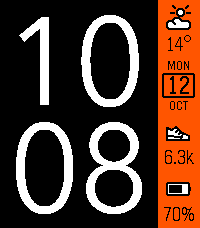
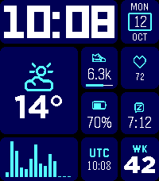
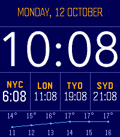
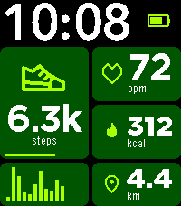
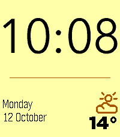
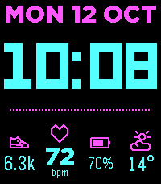

# TileStyle

A fully customizable Pebble Time 2 watchface: split the screen into a 4×4 grid,
merge cells into blocks and fill each with a widget — time, date, weather,
health and more.

Настраиваемый циферблат для Pebble Time 2 (платформа `emery`, 200×228,
64 цвета). Экран делится на сетку 4×4, ячейки объединяются в прямоугольные
блоки, в каждый блок ставится виджет. Идея и шрифты — от
[TimeStyle](https://github.com/freakified/TimeStylePebble).

<p>
  
  
  
</p>
<p>
  
  
  
</p>

## Возможности

- **Сетка 4×4.** Ширину столбцов и высоту строк можно двигать (минимум 20 px),
  ячейки можно объединять в блоки любого размера.
- **Виджеты:**
  - время (Avenir, Avenir DemiBold, LECO; в строку или часы над минутами);
  - дата по шаблону или «листок календаря», день недели, секунды, номер недели,
    второй часовой пояс, Swatch .beat;
  - батарея, Bluetooth;
  - шаги (с целью и графиком по часам), дистанция, калории, пульс, сон;
  - погода сейчас, мин/макс на сегодня, УФ-индекс, почасовой прогноз
    (колонки или график);
  - свой текст, разделитель.
- **Оформление:**
  - цвета темы и отдельно для каждого блока;
  - отступы и скругления блоков;
  - линии между блоками: сплошные, пунктир или точки.
- **12 готовых раскладок** и свои, сохранённые на телефоне.
- **Погода** из [Open-Meteo](https://open-meteo.com/) без ключа API, место
  определяется по GPS или выбирается вручную.
- **Превью страницы настроек** показывает экран попиксельно, как на часах:
  те же шрифты прошивки, иконки и раскладка.

Подписи на часах английские: в шрифтах прошивки нет кириллицы.

## Использование

1. Установите `.pbw` на часы через приложение Pebble (или соберите сам, см.
   ниже).
2. Откройте настройки циферблата в приложении. Откроется страница настроек
   (<https://muratovas.github.io/tileStylePebble/>):
   - выделите на превью ячейки и объедините их в блок;
   - выберите для блока виджет и его опции;
   - настройте тему, сетку и общие параметры: 12/24 ч, единицы, погода,
     вибрация при потере связи.
3. Нажмите «Сохранить»: настройки уйдут на часы, а погода обновится, если в
   раскладке есть погодные виджеты.

Пока настроек нет, часы показывают раскладку TimeStyle.

## Сборка

Нужны Pebble SDK 4.x, Node.js и npm. SDK ставится вместе с утилитой
`pebble`:

    uv tool install pebble-tool
    pebble sdk install latest

    git clone git@github.com:MuratovAS/tileStylePebble.git
    cd tileStylePebble
    npm install                             # библиотека pebble-fctx
    pebble build                            # -> build/tileStylePebble.pbw

Запуск:

    pebble install --emulator emery         # в эмуляторе Pebble Time 2
    pebble install --phone <IP телефона>    # на часы через приложение Pebble

Страница настроек (ветка `gh-pages`) подключается рабочей копией в папку
`config/`. Для сборки часов она не нужна, но её используют генераторы и
тесты из `tools/`:

    git worktree add config gh-pages

## Устройство репозитория

Ветки устроены как в TimeStyle:

- `main` — циферблат: код для часов и телефона, ресурсы, инструменты.
- `gh-pages` — страница настроек (статический HTML без сборки), её отдаёт
  GitHub Pages. Изменения страницы коммитятся из `config/`.

| Путь | Что внутри |
|---|---|
| `src/c/` | код часов: слой на каждый блок, виджеты, отрисовка, данные (Health, батарея, Bluetooth, погода), хранение настроек |
| `src/c/protocol.h` | обмен телефон ↔ часы: ключи сообщений, бинарные форматы настроек и погоды, id виджетов |
| `src/pkjs/` | код для телефона: открытие страницы настроек, перевод настроек в бинарный формат, погода Open-Meteo, очередь сообщений |
| `resources/` | шрифты цифр (`.ffont`) и иконки 14/18/25/36/50 px с исходниками |
| `tools/` | генераторы ресурсов и таблиц, тесты, отправка настроек в эмулятор |
| `config/` | страница настроек, рабочая копия `gh-pages` (в `main` игнорируется) |

Виджеты на C перенесены построчно из `config/js/widgets.js` и
`config/js/raster.js`. Поэтому часы рисуют то же, что превью, и при изменении
виджета нужно править обе стороны.

## Разработка

Тесты кода для телефона и бинарного формата:

    node tools/test_protocol.js && node tools/test_pkjs.js

Отправка раскладки и погоды в запущенный эмулятор, без страницы настроек:

    node tools/encode_config.js --list-presets
    python3 tools/send_appmessage.py --preset dashboard --demo-weather
    python3 tools/send_appmessage.py --config settings.json --live-weather 55.75,37.62

Демо-сборка подставляет тестовые данные превью (`MOCK` из `widgets.js`)
вместо Health и погоды. `DEMO_TIME` замораживает часы, так скриншот эмулятора
можно сравнить с превью попиксельно:

    touch src/c/*.c                         # waf не замечает смену переменных
    DEMO=1 DEMO_TIME=1791799717 pebble build
    pebble screenshot --emulator emery --no-correction shot.png

### Сгенерированные файлы

Их не правят руками, а пересобирают:

| Файл | Команда | Источник |
|---|---|---|
| `resources/icons/*.png` | `python3 tools/icons.py render` | `resources/icons_src/`, векторы из `widgets.js` |
| `config/js/icons.js` | `python3 tools/icons.py js` | `resources/icons/*.png` |
| `package.json` (иконки), `src/c/gen_icons.h` | `python3 tools/icons.py resources` | `resources/icons/*.png` |
| `src/c/gen_tables.c` | `python3 tools/gen_tables.py` | `config/js/sysfonts.js`, `config/js/fonts.js` |
| `config/js/sysfonts.js` | `python3 tools/pbf2js.py <PebbleOS>/resources > config/js/sysfonts.js` | шрифты прошивки из [PebbleOS](https://github.com/coredevices/PebbleOS) |
| `config/js/fonts.js` | `python3 tools/ffont2js.py resources/fonts > config/js/fonts.js` | `resources/fonts/*.ffont` |

Для `icons.py render` и `gen_tables.py` нужен headless Chromium: `chromium`
в `PATH`, браузер Playwright или путь в переменной `CHROME`.

Иконки двухцветные, как в TimeStyle: PNG с палитрой из прозрачного, белого
(заливка) и чёрного (обводка). Часы перекрашивают их сменой палитры: обводка
берёт цвет акцента блока, заливка — «Заливку иконок» из темы или фон блока.

### Формат настроек

Страница сохраняет настройки в JSON (v1). Код телефона переводит их в
компактный бинарный блоб, описанный в `src/c/protocol.h`.

```json
{
  "v": 1,
  "grid": { "cols": [53, 53, 52, 42], "rows": [57, 57, 57, 57] },
  "layout": [
    { "x": 0, "y": 0, "w": 3, "h": 4, "widget": "time",
      "opts": { "font": "avenir", "stack": "stack", "zero": true, "aa": false, "align": "center" } },
    { "x": 3, "y": 0, "w": 1, "h": 1, "widget": "weather",
      "bg": "#FF5500", "fg": "#000000", "accent": "#000000", "opts": { "align": "center" } }
  ],
  "theme": { "bg": "#000000", "tile": null, "fg": "#FFFFFF", "accent": "#FF5500", "iconFill": "#FFFFFF",
             "gap": 0, "radius": 0, "lineOn": false, "lineWidth": 1, "lineColor": "#FFFFFF", "lineStyle": "solid" },
  "general": { "clock24": true, "metric": true, "btVibe": true,
               "weatherSource": "manual", "weatherLocation": "Москва, Россия",
               "weatherLat": 55.7505, "weatherLon": 37.6175, "weatherInterval": 30 }
}
```

- `grid` — ширины столбцов и высоты строк в пикселях. Суммы всегда 200 и 228.
- `layout` — блоки в ячейках сетки, покрывают все 16 ячеек ровно по разу.
  `bg`/`fg`/`accent` блока необязательны, без них берутся цвета темы.
  В `opts` лежат все опции виджета, включая значения по умолчанию.
- `theme.tile: null` — у блоков нет своего фона; `iconFill: null` — заливка
  иконок цветом фона блока. `gap` вычитается пополам с внутренних сторон блоков.
- `weatherSource`: `gps`, `manual` (координаты места из подсказок
  OpenStreetMap Nominatim) или `off`.

Страница принимает текущие настройки параметром `?config=<json>`. При
сохранении она переходит на `return_to` (по умолчанию `pebblejs://close#`)
с JSON в хэше.

## Благодарности

- [TimeStyle](https://github.com/freakified/TimeStylePebble) (MIT): иконки,
  шрифты цифр, подход к погоде и странице настроек.
- [pebble-fctx](https://github.com/jrmobley/pebble-fctx): векторные цифры
  времени.
- [Open-Meteo](https://open-meteo.com/): погода.
